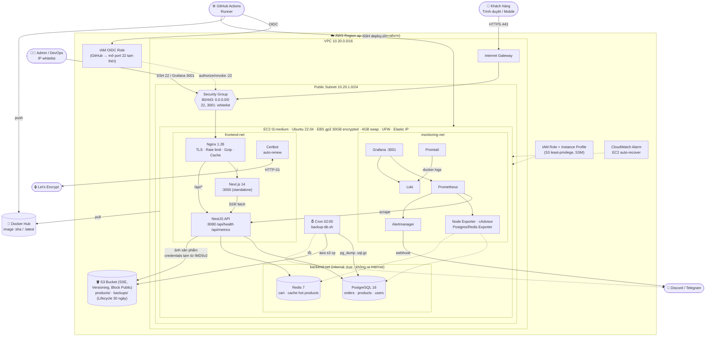
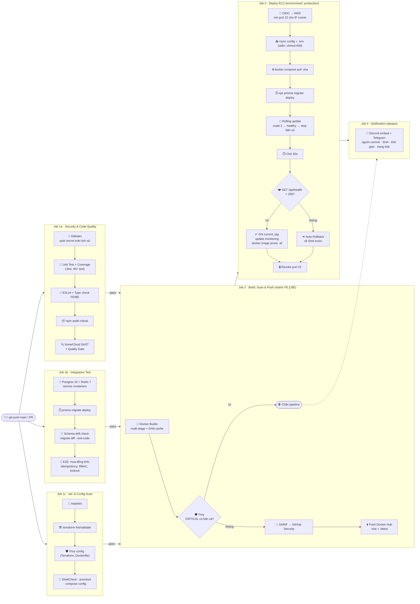
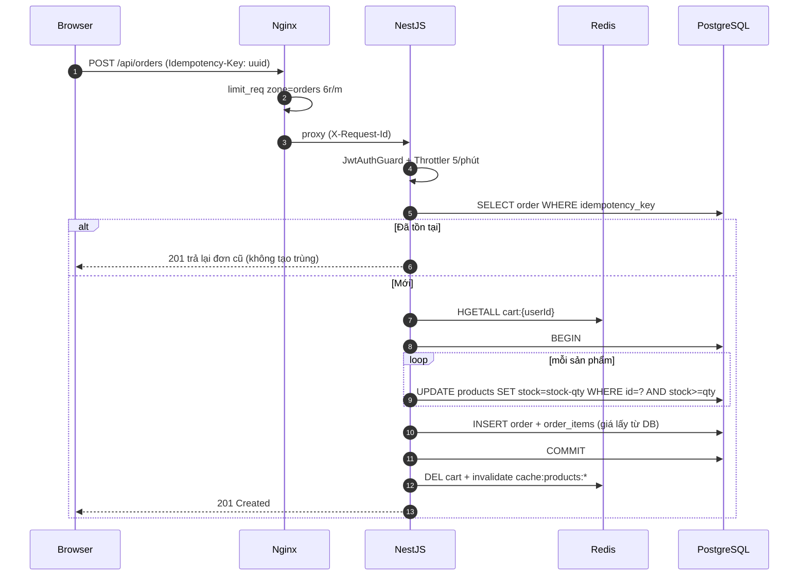

# Kiến trúc hệ thống - Home Shopping App

## 1. Sơ đồ kiến trúc trên AWS



## 2. Luồng CI/CD DevSecOps



## 3. Luồng đặt hàng & chống oversell



## 4. Cây thư mục Monorepo

```text
home-shopping-app/
├── .github/
│   └── workflows/
│   ├── workflows/production-cicd.yml  # Security ‖ Integration ‖ IaC → Build/Scan/Push → Deploy/Rollback → Notify
│   ├── dependabot.yml                 # Cập nhật dependency/bản vá hằng tuần
│   └── pull_request_template.md
├── backend/                           # NestJS 10 REST API (port 8080)
│   ├── prisma/
│   │   ├── migrations/
│   │   │   ├── 20261001000000_init/migration.sql
│   │   │   ├── 20261101000000_search_admin_indexes/migration.sql   # pg_trgm GIN, index admin, CHECK
│   │   │   └── migration_lock.toml
│   │   ├── schema.prisma
│   │   └── seed.js
│   ├── src/
│   │   ├── admin/                     # Dashboard thống kê, quản lý đơn (state machine)
│   │   ├── auth/                      # JWT (jti), logout/revoke, lockout brute-force, RolesGuard (+ spec)
│   │   ├── categories/                # Danh mục + số sản phẩm (cache Redis)
│   │   ├── cart/                      # Giỏ hàng trên Redis Hash (+ spec)
│   │   ├── common/filters/            # Global exception filter
│   │   ├── config/                    # Validate biến môi trường lúc khởi động
│   │   ├── health/                    # /api/health (DB + Redis, timeout 2s) (+ spec)
│   │   ├── metrics/                   # prom-client: http_requests_total, latency, orders
│   │   ├── orders/                    # Đặt hàng idempotent, trừ kho atomic, hủy + hoàn kho (+ spec)
│   │   ├── prisma/  redis/  storage/  # PrismaService, RedisService, S3 (IAM role)
│   │   ├── products/                  # Tìm kiếm/sắp xếp, CRUD, cache Redis, upload S3 (magic bytes)
│   │   ├── app.module.ts
│   │   ├── app.setup.ts               # Helmet, CORS, ValidationPipe, Swagger (dùng chung main + e2e)
│   │   └── main.ts
│   ├── test/app.e2e-spec.ts           # Integration test trên Postgres + Redis thật
│   ├── Dockerfile                     # multi-stage, non-root, HEALTHCHECK
│   ├── .dockerignore
│   ├── nest-cli.json  package.json  package-lock.json  tsconfig*.json
├── frontend/                          # Next.js 14 App Router (port 3000, output standalone)
│   ├── public/robots.txt
│   ├── src/
│   │   ├── app/                       # /, /products/[slug], /cart, /login, /orders, /orders/[id], /admin, /healthz
│   │   ├── components/                # Header, ProductCard, AddToCartButton, RequireAuth, admin/*
│   │   └── lib/                       # server-api (SSR), client-api (browser), types
│   ├── Dockerfile                     # multi-stage, non-root, gỡ npm khỏi runtime
│   ├── .dockerignore
│   ├── next.config.mjs  package.json  package-lock.json  tsconfig.json
├── nginx/
│   ├── nginx.conf                     # Production: TLS, rate limit, gzip, cache, upstream resolve
│   ├── local.conf                     # Demo local HTTP
│   └── snippets/
│       ├── proxy-params.conf
│       └── security-headers.conf
├── terraform/
│   ├── versions.tf                    # provider + (tùy chọn) remote state S3
│   ├── main.tf                        # VPC, Subnet, IGW, RT, SG, S3, IAM, OIDC, EC2, EIP, Alarm
│   ├── variables.tf                   # có validation (cấm 0.0.0.0/0 cho SSH/Grafana)
│   ├── outputs.tf
│   └── terraform.tfvars.example
├── monitoring/
│   ├── docker-compose.monitoring.yml
│   ├── prometheus/{prometheus.yml, alert.rules.yml}
│   ├── alertmanager/alertmanager.yml.tmpl
│   ├── loki/loki-config.yaml
│   ├── promtail/promtail-config.yaml
│   └── grafana/
│       ├── provisioning/{datasources,dashboards}/
│       └── dashboards/home-shopping-overview.json
├── scripts/
│   ├── user_data.sh                   # Bootstrap EC2: swap, Docker, sysctl, UFW, fail2ban, cron
│   ├── deploy.sh                      # Zero-downtime rolling update + auto-rollback
│   ├── init-letsencrypt.sh            # Cấp cert lần đầu
│   ├── backup-db.sh                   # pg_dump → gzip → S3, cảnh báo Discord khi lỗi
│   ├── restore-db.sh                  # Disaster recovery từ S3
│   └── render-alertmanager.sh         # Sinh alertmanager.yml từ secret
├── docs/
│   ├── ARCHITECTURE.md
│   └── DEFENSE-QA.md
├── docker-compose.prod.yml            # frontend-net / backend-net(internal), limits, log rotation
├── docker-compose.local.yml           # Demo local 1 lệnh
├── sonar-project.properties
├── .hadolint.yaml  trivy.yaml  .trivyignore   # Cấu hình quét IaC (ngoại lệ có ghi lý do)
├── .gitleaks.toml  .gitignore  .gitattributes  .env.example
├── Makefile
└── README.md
```
